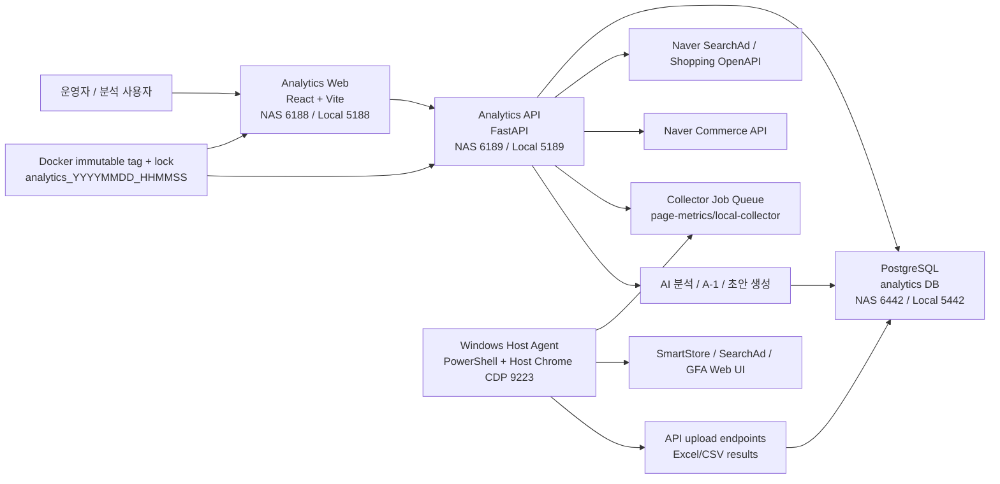
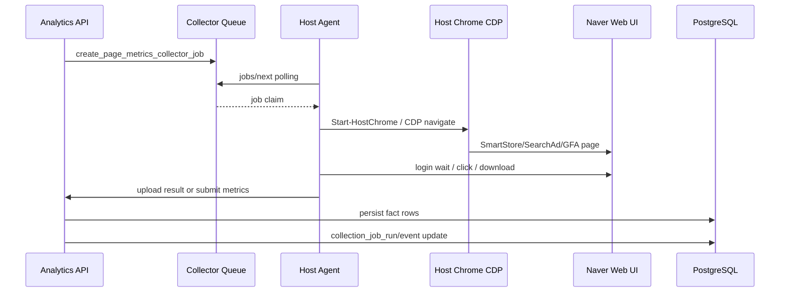
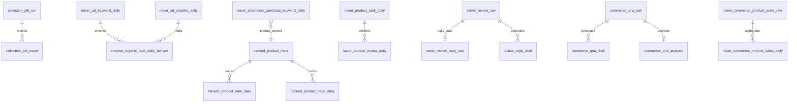
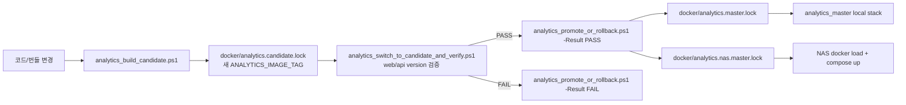

# ERP2 Analytics 데이터 기반 구조도 및 기술서

- 작성일: 2026-08-07
- 기준 시스템: ERP2-analytics
- 기준 배포 태그: `analytics_20260807_091850`
- 기준 데이터: NAS PostgreSQL `analytics` DB 운영 데이터
- 주요 포트: Web `6188`(NAS), API `6189`(NAS), DB `6442`, Host Chrome CDP `9223`, API debug CDP `29222`

## 1. 목적

ERP2 Analytics는 광고, 검색, 쇼핑, 구매, 리뷰, Q&A 데이터를 한 저장소와 한 운영 스택에서 수집·분석·운영하기 위한 분석 전용 프로젝트다. 본 문서는 현재 저장되어 있는 NAS 운영 DB 데이터를 기준으로 실제 데이터 규모와 수집 흐름을 확인하고, 그에 맞춰 시스템 구조도와 기술 구성을 정리한다.

핵심 목적은 다음과 같다.

- 광고 성과, 검색어, 소재, GFA, 쇼핑 순위, 구매 키워드, 리뷰, Q&A 데이터를 일 단위로 축적한다.
- OpenAPI, Commerce API, CDP Host Agent, 파일 업로드 등 서로 다른 수집 방식을 하나의 수집 허브에서 추적한다.
- 수집 결과를 웹 UI에서 분석하고, AI 분석/자동화 기능의 입력 데이터로 재사용한다.
- NAS 운영 환경에서 불변 이미지 태그와 lock 파일을 기준으로 배포 상태를 증명한다.

## 2. 데이터 기반 현황

### 2.1 주요 테이블 규모

아래 값은 NAS PostgreSQL 운영 DB에서 조회한 주요 테이블의 실제 row 수와 날짜 범위다.

| 영역 | 테이블 | row 수 | 날짜 범위 |
|---|---:|---:|---|
| 광고 검색어 | `naver_ad_searchword_daily` | 492,692 | 2026-01-01 ~ 2026-08-06 |
| GFA 성과 | `naver_gfa_performance_daily` | 206,087 | 2024-06-19 ~ 2026-08-06 |
| 쇼핑 검색 순위 | `naver_product_rank_daily` | 152,150 | 2025-12-10 ~ 2026-08-07 |
| 내 상품 추적 순위 | `tracked_product_rank_daily` | 132,393 | 2025-07-11 ~ 2026-08-07 |
| 광고 소재 | `naver_ad_creative_daily` | 122,674 | 2025-07-25 ~ 2026-08-06 |
| 광고 키워드 | `naver_ad_keyword_daily` | 80,924 | 2025-06-21 ~ 2026-08-06 |
| 광고 노출 진단 | `ad_rank_diagnosis_daily` | 18,144 | 2026-07-29 ~ 2026-08-06 |
| 구매 키워드 | `naver_smartstore_purchase_keyword_daily` | 17,627 | 2025-10-01 ~ 2026-08-06 |
| 상품 리뷰 요약 | `naver_product_review_daily` | 12,842 | 2025-12-28 ~ 2026-06-01 |
| 리뷰 원문 | `naver_review_raw` | 8,467 | 2023-08-10 ~ 2026-08-07 |
| 리뷰 답글 원문 | `naver_review_reply_raw` | 6,397 | 2026-04-01 ~ 2026-04-15 |
| Q&A 원문 | `commerce_qna_raw` | 1,578 | 2025-01-01 ~ 2026-08-05 |
| 상품 페이지 지표 | `tracked_product_page_daily` | 948 | 2025-12-28 ~ 2026-08-07 |

### 2.2 대용량 테이블 순위

`pg_stat_user_tables` 기준 row 추정치 상위 테이블은 다음과 같다.

| 순위 | 테이블 | 추정 row 수 | 의미 |
|---:|---|---:|---|
| 1 | `naver_ad_searchword_daily` | 492,692 | 광고 검색어 성과 fact |
| 2 | `naver_product_rank_daily` | 152,150 | 네이버 쇼핑 검색 순위 fact |
| 3 | `naver_gfa_performance_daily` | 132,113 이상 | GFA 성과 리포트 fact |
| 4 | `tracked_product_rank_daily` | 131,860 이상 | 내 상품 수동/자동 추적 순위 |
| 5 | `naver_ad_creative_daily` | 122,674 | 광고 소재 성과 fact |
| 6 | `naver_ad_keyword_daily` | 80,924 | 광고 키워드 성과 fact |
| 7 | `creative_organic_rank_daily_derived` | 29,489 | 광고 소재와 오가닉 순위 파생 결과 |
| 8 | `ad_rank_diagnosis_daily` | 18,144 | CDP 기반 광고 노출 진단 |
| 9 | `naver_commerce_product_order_raw` | 17,666 | Commerce 주문 원천 |
| 10 | `naver_smartstore_purchase_keyword_daily` | 17,627 | 구매 키워드 일간 fact |

### 2.3 구매 키워드 데이터 출처

`naver_smartstore_purchase_keyword_daily`는 세 가지 출처가 공존한다.

| source | row 수 | 날짜 범위 | 결제수 합계 | 결제금액 합계 |
|---|---:|---|---:|---:|
| `purchase_upload` | 8,649 | 2025-10-01 ~ 2026-04-15 | 6,774.52 | 318,990,375 |
| `smartstore_cdp` | 5,089 | 2026-03-11 ~ 2026-08-06 | 4,256.86 | 165,701,439 |
| `purchase_commerce_api` | 3,889 | 2026-02-12 ~ 2026-05-31 | 9,380.00 | 314,861,100 |

해석:

- 과거 데이터는 수동 업로드(`purchase_upload`) 비중이 크다.
- 최근 자동화는 SmartStore CDP(`smartstore_cdp`)가 담당한다.
- Commerce API 기반 집계(`purchase_commerce_api`)는 주문 원천에서 구매 키워드 유사 fact를 재구성하는 보조 경로다.

### 2.4 최근 14일 수집 안정성

최근 14일 `collection_job_run` 기준 주요 수집 상태는 다음과 같다.

| 수집 작업 | SUCCESS | PARTIAL | FAILED | CANCELLED | 관찰 |
|---|---:|---:|---:|---:|---|
| `purchase_keywords` | 11 | 2 | 11 | 0 | 로그인/CDP 의존성이 가장 큰 리스크 |
| `rank_openapi` | 11 | 0 | 4 | 0 | 쇼핑 순위 수집은 일부 실패 후 회복 |
| `gfa_performance_daily` | 14 | 4 | 5 | 1 | GFA 리포트 다운로드/업로드 복원력 필요 |
| `ad_rank_diagnosis_cdp` | 6 | 11 | 0 | 1 | 부분 저장은 많지만 데이터 축적은 진행됨 |
| `reviews_collect` | 16 | 0 | 1 | 0 | 대체로 안정 |
| `qna_collect` | 14 | 0 | 0 | 0 | Commerce API 기반 안정 |
| `sales_orders` | 14 | 0 | 0 | 0 | Commerce API 기반 안정 |

운영 관찰:

- 서버 API 기반 수집(`qna_collect`, `sales_orders`, `review_daily_backfill`)은 안정적이다.
- CDP 기반 수집은 로그인, 화면 변경, 다운로드 타이밍에 민감하다.
- 구매 키워드는 최근 자동 스케줄에서 `login_wait_timeout`과 `no_db_rows_saved`가 반복되어, Host Agent 시작 URL과 로그인 warm-up이 핵심 개선 지점이다.

## 3. 전체 시스템 구조도

## 4. 런타임 구성

### 4.1 Web

- 위치: `web/`
- 주요 기술: React 18, Vite, TypeScript
- 로컬 포트: `5188`
- NAS 포트: `6188`
- 주요 모듈:
  - `web/src/modules/layout/`: 앱 셸, 메뉴, 순위 추적 화면
  - `web/src/modules/ads/`: 광고 성과, 키워드, 소재 분석
  - `web/src/modules/purchase/`: 구매 키워드 분석
  - `web/src/modules/reviews/`: 리뷰, Q&A, 답글 초안/분석
  - `web/src/modules/research/`: SEO, 해시태그, 상품 지수
  - `web/src/modules/ai/`: A-1 분석, AI 운영 센터
  - `web/src/modules/settings/`: API 설정, 데이터 수집, Host Agent 릴리스

### 4.2 API

- 위치: `api/`
- 주요 기술: FastAPI, SQLAlchemy, Pandas, Playwright/CDP 보조 로직
- 로컬 포트: `5189`
- NAS 포트: `6189`
- 주요 파일:
  - `api/main.py`: API 엔드포인트, 수집 오케스트레이션, 업로드 처리, AI 분석 로직
  - `api/db.py`: SQLAlchemy 모델과 테이블 정의
  - `api/schemas.py`: 요청/응답 스키마
  - `api/requirements.txt`: 런타임 의존성

API 주요 도메인:

- `/collection/*`: 수집 작업 스케줄, 실행, 이력, 이벤트
- `/search-rank/*`: 쇼핑 순위, 페이지 지표, Host Agent collector job
- `/purchase/*`: 구매 키워드 업로드/동기화
- `/ads/*`: 광고 키워드/검색어/소재/GFA 성과
- `/reviews/*`: 리뷰 수집, 분석, 답글 초안
- `/qna/*`: Q&A 수집, 분석, 답변 초안
- `/ai/*`: AI 분석, A-1 포트폴리오/상품 분석
- `/settings/*`: API/AI/운영 설정
- `/admin/*`: 버전, 백업, 사용자 관리

### 4.3 DB

- DBMS: PostgreSQL 16
- NAS 컨테이너: `analytics-nas-db`
- 로컬 컨테이너: `analytics-master-db`
- 핵심 테이블 그룹:
  - 광고 fact: `naver_ad_keyword_daily`, `naver_ad_searchword_daily`, `naver_ad_creative_daily`
  - GFA fact/inventory: `naver_gfa_performance_daily`, `naver_gfa_campaign_inventory`, `naver_gfa_adgroup_inventory`, `naver_gfa_creative_detail`
  - 쇼핑/순위: `naver_product_rank_daily`, `tracked_product_rank_daily`, `tracked_product_page_daily`
  - 구매: `naver_smartstore_purchase_keyword_daily`, `naver_commerce_product_order_raw`, `naver_commerce_product_sales_daily`
  - 리뷰/Q&A: `naver_review_raw`, `naver_review_reply_raw`, `commerce_qna_raw`, draft/analysis 테이블
  - 운영 이력: `collection_job_run`, `collection_job_event`, `analytics_job_run`
  - AI 파생: `analysis_run`, `analysis_blob`, `analysis_trace_node`, `analysis_trace_edge`, `action_queue`

## 5. 데이터 수집 구조

### 5.1 수집 허브

`COLLECTION_TASK_REGISTRY`는 수집 가능한 작업을 task 단위로 정의한다. 실제 실행은 `/collection/tasks/{task_id}/run`, `/collection/run-all`, 스케줄러, 또는 Host Agent collector queue를 통해 이뤄진다.

주요 task:

- `sales_orders`: Commerce API 주문/판매 수집
- `purchase_keywords`: SmartStore 구매 키워드 수집
- `rank_openapi`: 쇼핑 순위/페이지 지표 수집
- `reviews_collect`, `review_daily_backfill`, `review_reply_backfill`
- `qna_collect`
- `ads_daily`, `ads_searchword_daily`, `ads_creative_report_daily`
- `gfa_campaign_inventory`, `gfa_adgroup_inventory`, `gfa_performance_daily`, `gfa_creative_detail`
- `ad_rank_diagnosis_cdp`
- `product_index_daily`, `page_metrics_cdp`

### 5.2 Host Agent CDP 흐름

현재 구매 키워드 개선 사항:

- 이전 방식: `https://sell.smartstore.naver.com/home`으로 warm-up 후 Commerce 로그인으로 이동
- 개선 방식: 처음부터 `https://accounts.commerce.naver.com/login?url=https%3A%2F%2Fsell.smartstore.naver.com%2F%23%2Flogin-callback`로 시작
- 목적: 새벽 스케줄 첫 CDP 작업에서 SmartStore home 대기 상태로 고착되는 것을 방지

## 6. 데이터 모델 구조도

## 7. 배포 및 운영 구조

### 7.1 불변 태그 흐름

### 7.2 주요 운영 스크립트

| 목적 | 스크립트 | 설명 |
|---|---|---|
| 표준 재빌드/검증/승격 | `scripts/analytics_rebuild_and_verify.ps1` | candidate 빌드, 검증, PASS 승격/FAIL 롤백 |
| NAS 배포용 이미지 tar 생성 | `scripts/generate-analytics-nas-images-tar.ps1` | master lock 태그 기준 web/api 이미지 `docker save` |
| NAS 동기화 파일 묶음 | `scripts/generate-analytics-nas-sync-files.ps1` | NAS lock/yml/운영 스크립트 zip 생성 |
| NAS 로드/재기동/검증 | `scripts/verify-analytics-nas-after-copy.ps1` | 사용자가 tar 복사 후 docker load, compose up, version 검증 |
| NAS 전체 배포 | `scripts/deploy-analytics-nas.ps1` | tar 업로드까지 포함한 full deploy |
| Host Agent embed | `scripts/embed-host-agent-into-nas-installer.mjs` | root `tools/host-agent.ps1`을 NAS installer에 base64 내장 |

## 8. 기술적 리스크와 개선 우선순위

### 8.1 CDP 로그인 의존성 - 해결 완료

근거:

- 최근 14일 `purchase_keywords`는 `SUCCESS 11`, `PARTIAL 2`, `FAILED 11`이다.
- 오늘 실패 job은 `login_wait_timeout`으로 1시간 대기 후 `no_db_rows_saved`가 발생했다.

적용 완료:

- 구매 키워드는 처음부터 Commerce 로그인 URL로 시작하도록 변경했다.
- Host Agent 버전/관리번호를 올려 설치본 업데이트가 감지되도록 했다.
- 새 Host Agent 설치/재시작 후 수동 1회 검증 대상으로 전환했다.

### 8.2 수집 완료 판정 - 개선 완료

근거:

- `collection_job_run`은 결과 저장 후 `db_persistence`로 실제 rows를 검증한다.
- 저장이 0건이면 `no_db_rows_saved`로 실패 처리된다.

대응:

- Collector 완료 시 `collector_diagnostics`를 `detail_json`과 `collection_job_event.detail_json`에 남기도록 개선했다.
- 실패 원인은 `login_timeout`, `cdp_runtime_timeout`, `download_failed`, `upload_failed`, `persistence_empty`, `valid_no_data` 등으로 분류된다.
- `stage_counts`, `category_counts`, `sample_errors`, `retryable_error_count`, `items_with_rows`를 같이 저장해 장애 분석 시간을 줄인다.

### 8.3 대용량 광고 데이터 - 개선 완료

근거:

- `naver_ad_searchword_daily`가 492,692 rows로 가장 크다.
- GFA/소재/순위 fact도 10만 row 이상이다.

대응:

- `naver_ad_searchword_daily`, `naver_ad_creative_daily`, `naver_product_rank_daily`, `tracked_product_rank_daily`에 날짜/캠페인/상품/키워드/source 기준 복합 인덱스를 추가했다.
- 운영 PostgreSQL 기존 테이블에도 `CREATE INDEX IF NOT EXISTS`로 방어적으로 생성되도록 `init_db()`에 반영했다.
- UI 조회는 기간 제한과 server-side aggregation을 기본으로 유지해야 한다.

### 8.4 NAS 배포 일관성

근거:

- Web/API는 불변 태그와 `/version.json`, `/api/version`으로 검증된다.
- Host Agent는 Web bundle 내부 installer 버전까지 별도 검증해야 한다.

대응:

- 배포 검증 시 `NAS-served Host Agent installer release` 확인을 필수로 유지한다.
- 이미지 tar 복사를 수동으로 할 때는 partial tar 덮어쓰기와 크기 검증을 반드시 수행한다.

## 9. 저장소 및 런타임 세부 부록

### 9.1 저장소 레이아웃

| 경로 | 역할 |
|---|---|
| `web/` | React 18 + Vite + TypeScript SPA, 운영 시 nginx 정적 서빙 |
| `api/` | FastAPI API, SQLAlchemy 모델, 수집/업로드/AI 분석 로직 |
| `docker/` | compose YAML과 불변 태그 lock 파일 |
| `scripts/` | build, verify, promote, local/NAS lifecycle, menu sync 자동화 |
| `tools/` | Windows Host Chrome CDP, Host Agent, 수동 수집 도구 |
| `web/public/local`, `web/public/nas` | Host Agent 설치/실행 스크립트 배포 위치 |
| `docs/` | 운영/기술 문서 |

### 9.2 주요 API prefix

| Prefix | 역할 |
|---|---|
| `/health`, `/version`, `/api/version` | 상태와 배포 태그 증거 |
| `/collection/*` | 수집 task, job run, event, collector token |
| `/ads/*`, `/gfa/*` | SearchAd, GFA 수집/분석/생성 |
| `/purchase/*` | 구매 키워드 업로드, 동기화, 대시보드 |
| `/sales/*` | Commerce 판매/주문 동기화와 분석 |
| `/search-rank/*` | 오가닉 순위, 페이지 지표, 상품 지수, 로컬 collector queue |
| `/ad-rank/*` | 광고 노출 순위 진단 |
| `/reviews/*`, `/qna/*` | 리뷰/Q&A 수집, 분석, 답글/답변 초안 |
| `/ai/*` | AI chat, A-1 분석, AI Ops Center |
| `/settings/*`, `/admin/*`, `/menu-sync/*` | 설정, 관리자, 버전/백업, 메뉴 동기화 |

### 9.3 인증과 보안 운영

- NAS 운영은 Firebase ID token 기반 인증을 사용하며, 민감 route는 role/level 검사를 거친다.
- API/AI 설정은 DB 저장을 기준으로 하며, lock 파일에는 secret을 넣지 않는다.
- Web은 같은 origin의 `/api` 프록시를 기본으로 사용하고, NAS에서는 `REQUIRE_FIREBASE_AUTH=1`로 fail-fast 한다.

### 9.4 런타임 산출물

| 산출물 | 위치/이름 | 생성 주체 |
|---|---|---|
| Docker image | `analytics-analytics-api:<tag>`, `analytics-analytics-web:<tag>` | candidate build |
| 배포 lock | `docker/analytics.*.lock` | build/promote scripts |
| Web bundle/version | nginx html root, `version.json` | Vite + Dockerfile |
| Host Agent status | `%LOCALAPPDATA%\ERP2-Analytics-HostChrome\collector-background.*.json` | `host-agent.ps1` |
| GFA 생성 이미지 | `/data/gfa_generated_creatives` | API |
| Playwright profile | `/data/playwright` | API container |
| NAS image tar | `generate-analytics-nas-images-tar.ps1` 결과물 | 배포 파이프라인 |
| DB backup | `/admin/backup` | API + pg_dump |
| AI 분석 blob | `analysis_run`, `analysis_blob`, trace tables | AI/A-1 pipeline |

## 10. 현재 기준 핵심 결론

ERP2 Analytics는 단순 대시보드가 아니라, CDP/공식 API/파일 업로드/AI 분석을 통합한 운영형 데이터 플랫폼이다. 저장된 데이터 규모를 보면 광고 검색어, GFA 성과, 쇼핑 순위, 광고 소재가 이미 핵심 대용량 fact 축으로 자리 잡았고, 구매 키워드와 리뷰/Q&A는 제품 의사결정 및 AI 분석의 품질 데이터를 제공한다.

가장 중요한 운영 개선 지점은 구매 키워드 CDP 수집의 로그인 안정성이다. 이 영역만 안정화되면 현재 DB에 쌓인 광고/검색/구매/리뷰/Q&A 데이터가 하나의 상품 운영 판단 흐름으로 더 안정적으로 연결된다.
